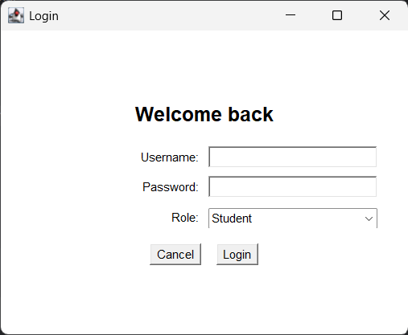
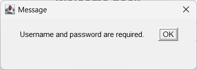
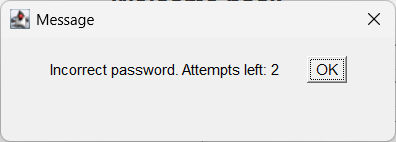
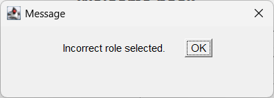
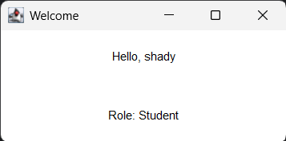

# Java AWT Login Form

A simple **Java AWT** login form for practicing GUI components and event
handling.

## Features

-   Checks that the username and password are not empty.
-   Checks the username and password against hard-coded users.
-   Checks that the selected role matches the user's role.
-   Shows a simple message when the entered information is incorrect.
-   Disables the Login button after **3 incorrect passwords** for a
    known username.
-   Opens a welcome window after a successful login.

## Screenshots

### Login form

### Empty fields validation

### Invalid username or password

### Incorrect password attempts

### Incorrect role

### Login disabled after three incorrect passwords

### Successful login

## Test Accounts

  Username      Password   Role
  ------------- ---------- -----------
  `shady`       `1234`     Student
  `ahmed`       `5678`     TA
  `professor`   `9999`     Professor

These are demo credentials stored directly in the code.

## Run

1.  Open the project in your Java IDE.
2.  Make sure `LoginFormTask.java` is in the project.
3.  Run `LoginFormTask`.

## Technologies

-   Java
-   AWT (`Frame`, `Panel`, `Label`, `TextField`, `Choice`, `Button`,
    `Dialog`)
-   Event handling (`ActionListener`, `WindowAdapter`)

## Note

This is a small educational example. The users and passwords are
hard-coded for practice, not for production use.
